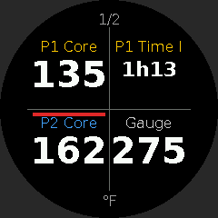
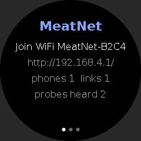

# MeatNet Display (ESP32-S3 + GC9A01A, and Linux)

> [!NOTE]
> This project was written with the assistance of an LLM (Anthropic's Claude,
> via Claude Code). It has been tested on real hardware, but review the code
> before relying on it.

Turns a **Waveshare ESP32-S3-LCD-1.28** (or any ESP32-S3 with a GC9A01A round
LCD) or a Linux computer with Bluetooth into a Combustion Inc. **MeatNet
node** that relays between the Combustion phone app and probes/nodes that
would otherwise be out of range, and shows their readings on the round
screen. Configured from a web page (no buttons needed). Everything is C++:
one shared core (`core/`) built into the ESP32 firmware (`firmware/`) and
the Linux unit (`linux/`).

What it does:

- **Advertises as a Display (product type 4)** and re-broadcasts every probe
  it hears as repeated MeatNet data (hop count set). The app sees live
  temperatures from probes that are out of its own range.
- **Relays probes you pick on the web page.** It holds a BLE connection to
  each one and forwards the full Probe Status (0x45) to the app: predictions,
  food-safe status, alarms. It also routes the app's commands to the probe:
  set prediction, alarms, probe ID/colour, food safe, reset, silence alarms,
  and **log reads** for the cook graph. Requests are translated between the
  MeatNet node format and the probe's own UART format.
- **Behaves as a MeatNet node towards other nodes** (experimental):
  - answers Read Probe List, Node List and Network Topology;
  - sends heartbeats and Device Connected/Disconnected messages;
  - keeps link/unlink tables and syncs them with peers (0x73–0x7B);
  - syncs the thermometer list (0x4B);
  - can hold **upstream** links to other nodes (Booster/Display/Gauge/
    Engine), one or several. Their probes, Gauge and Engine data reach the
    app through this device, and commands are routed back. Linking both a
    Gauge and the Engine directly keeps the Engine reachable when the Gauge
    link drops (each takes a connection slot).
- **Round-screen readings** in two layouts: *rotate* (one big reading per
  page, with surface/ambient and time-to-ready underneath) or *quad* (four
  per page). An optional status page shows the IP, connections and probes
  heard. A red ring means a probe alarm is going off.

    
- **Web page** at `http://meatnet.local/` (the `hostname` setting):
  - live status and log;
  - probes and devices heard, with a relay checkbox per probe;
  - display settings and the list of readings to show;
  - WiFi scan and setup, setup-network password;
  - radio and advanced options.

## Roles

One board can do everything, or two units can split the job when the phone
and the devices can't all be in Bluetooth range of one place. The **Role**
setting (web page, applied after a reboot) picks:

| Role | Place it | Does |
|---|---|---|
| `standalone` | between the phone and the devices | Everything below, on one radio |
| `app` | near the phone | Advertises as the Display, talks to the Combustion app, repeats probes, runs the screen and the web page with all probe/MEATER/display settings |
| `field` | near the probes, MEATER, Gauge, Engine | Scans and holds the Bluetooth links to the devices for the app unit; doesn't advertise and isn't visible to phones |

Any unit can be an ESP32 or a Linux computer, in any combination.

## ESP32 setup

### 1. Flash

Take `meatnet-esp32s3.bin` from the latest
[GitHub release](https://github.com/astephon88/meatnet-display/releases) (or
build it, see [Development](#development)) and flash it with esptool
(`python -m pip install esptool`).

**The Waveshare ESP32-S3-LCD-1.28** needs the download mode selected by
hand: its USB-serial chip (CH343) can't, and esptool's automatic reset
doesn't get there. So:

1. Start esptool first, set to keep retrying the connection:
   ```
   python -m esptool --chip esp32s3 -p /dev/serial/by-id/<CH343 device> \
     --before no_reset --after no_reset --connect-attempts 0 \
     write_flash 0x0 meatnet-esp32s3.bin
   ```
   (From a build, run it in `firmware/build` with `@flash_args` instead of
   `0x0 meatnet-esp32s3.bin`.)
2. **Then** hold BOOT, press and release RESET, and keep holding BOOT for a
   second before releasing it. esptool connects and writes.
3. Afterwards, press RESET to run the new firmware.

Use the `/dev/serial/by-id/…` path, since `/dev/ttyACM*` numbering changes on
replug. If esptool never syncs and the serial output shows `rst:0x1
(POWERON)` after each write, or I/O errors appear, the cable or USB port is
flaky: re-plug the board. After a failed flash the board stays in download
mode, so the next esptool run connects at once.

### 2. First run

With no WiFi set, or if the saved network can't be joined within 30 s, the
board opens a setup network called **`MeatNet-<serial>`** (open, or with the
setup-network password once one is set), and the screen shows its name and
address. Join it from your phone; most phones open the setup page by
themselves (captive portal). Pick your network from the scan, enter the
password and save, then reboot. While the setup network is up, the board
retries the saved network every minute, as long as nobody is connected to
it.

On your network the screen's status page shows the board's IP, and it's
reachable at `http://<hostname>.local/` (default `meatnet.local`).

### 3. Use

- **One board:** keep the role `standalone`. In **Probes**, tick **Relay**
  on the probes it should connect to. The app then shows them through this
  Display, with predictions and history, even when the phone can't reach
  the probe.
- **Two units:** set one to `app` and the other to `field`, with the same
  **Shared key** on both, and reboot them. The field unit finds the app unit
  by a UDP broadcast beacon; if your network blocks broadcasts, enter the app
  unit's address on the field unit. Do all the configuration (relayed
  probes, MEATER bridge, upstream nodes, display) on the app unit.

Settings live in the board's flash (NVS) and survive firmware updates.

## Linux unit

`linux/` runs any role on a Linux computer with Bluetooth, through BlueZ
(5.64 and 5.79 tested) over D-Bus. It needs no root and serves the same web
page. Build it with CMake and GLib (`libglib2.0-dev` on Debian/Ubuntu,
`glib-dev` on Alpine):

```
cmake -S . -B build-sys && cmake --build build-sys -j
./build-sys/linux/meatnet app        [--config host/app.json]   [--web-port 8080]
./build-sys/linux/meatnet field      [--config host/field.json] [--web-port 8081] [--peer <ip>]
./build-sys/linux/meatnet standalone [--config host/standalone.json]
```

Releases also carry `meatnet-linux-x86_64`, built for Alpine 3.21 (it needs
`glib` and `libstdc++`). Settings are a JSON file per unit (git-ignored under
`host/` by default), editable on the web page; `--peer` and `--key` (or
`--key-file`) override them without being saved. "Reboot" on the web page
restarts the process.

**BlueZ setting: turn off EATT.** BlueZ 5.6x and later open Enhanced ATT
channels to every device that connects, and those need an encrypted link, so
it asks phones to pair. The phone shows a pairing prompt, and unless it's
answered the link drops after the 30 s security timeout, over and over, so a
probe's history never finishes uploading. Allow plain ATT only in
`/etc/bluetooth/main.conf` and restart bluetoothd:

```ini
[GATT]
Channels=1
```

Also good to know:

- On start the unit drops any connections BlueZ still holds to MeatNet
  devices or MEATERs (a connected device stops advertising, so it would never
  be heard again). When bluetoothd restarts it restarts itself, since BlueZ
  forgets its GATT server and advertisements; after an adapter power cycle it
  resumes scanning.
- Probe links from Linux can't grant a probe's 500–1000 ms idle interval: the
  kernel caps the intervals a device asks for at the adapter's maximum (50 ms
  by default). Probes stay on a faster interval and use a little more battery
  than with an ESP32.
- BlueZ picks the advertising interval (about 1 s rather than the ESP32's
  250 ms), so the app may take a little longer to find the Display.

## MEATER Pro bridge

Publishes MEATER Pro probes on MeatNet as if they were Combustion probes, so
the Combustion app and other MeatNet devices see their temperatures. Turn on
**MEATER bridge** on the web page, then tick the MEATER(s) to bridge and pick
the probe number each should show as (1–8).

- The MEATER only sends temperatures over a connection, so the device holds
  a link to each bridged MEATER. Each one uses a relay slot, shared with
  relayed Combustion probes. The MEATER app can't connect to that MEATER
  while it's bridged.
- Each bridged MEATER is advertised as a repeated Combustion probe (via this
  node, 1 hop) with serial `4Dxxxxxx`, derived from the MEATER's address.
  The sensors map as follows:
  - **T8 (ambient)** = MEATER ambient (handle) sensor.
  - **T1–T7** = the 5 MEATER tip sensors spread linearly: T1 = tip 1,
    T7 = tip 5, the rest interpolated.
  - **Core** = the lowest of T1–T6. Combustion's core field can't name T7.
  - **Surface** = T7.
  - **Low battery** is flagged below 20%.
- The Display also presents each bridged MEATER as one of its own MeatNet
  probes, the way it does for relayed probes. The app learns about probes
  reached through a node this way, not from repeated advertisements alone.
  - It's listed in the Display's probe list (0x44).
  - Its full probe status (0x45) is sent on every update, with a session ID,
    a 5 s sample period and "probe inserted, no prediction".
  - The Display answers session info (0x03).
  - It keeps a temperature log (last 6 h, every 5 s) so the app can
    back-fill the cook graph (0x04 log reads, sent paced).
  - It answers firmware/hardware/model-info requests (0x46–0x48), shaped
    like a real probe's (model `00001011:MEATER`, firmware `v2.4.0`).
  - It's added to the Display's linked-devices table and announced with
    Device Linked (0x77) when bridging starts. It stays linked after
    un-bridging; unlink it from the app if needed.
  - Setting the probe ID/colour from the app is applied to the bridge.
    Predictions, alarms, food safe and resets aren't possible for a MEATER,
    so the app gets a failure response.
- **Direct-probe advertisement (on by default):** each bridged MEATER is
  also advertised the way a probe advertises itself (product type 1). The
  Combustion app only *discovers* new probes from these; repeated data
  through a node only updates probes it already knows. It's sent
  **non-connectable**, so the app can't try to connect to the Display as if
  it were the probe and reaches it through the Display instead. To add it in
  the app, find it in the unlinked devices list and hold the phone close to
  the Display. The app only offers to link nearby devices.
- MEATERs are found by name or service UUID, which may only be in the scan
  response, so scanning is active (sends scan requests) while the bridge is
  on.
- A MEATER that stops sending for 10 s drops out of the advertisements.

## Two-unit notes

- The two units use TCP port 7389 (configurable) on your LAN. The shared key
  stops a stray device from attaching, but the traffic isn't encrypted.
- All of the field unit's Bluetooth connections are available for devices.
  None are reserved for phones; phones connect to the app unit.
- If the field unit drops off WiFi, the app unit shows its links as
  "field unit offline". Relayed probes disappear until it's back, and then
  the links are re-opened automatically. Standby on the app unit also puts
  the field unit into standby.
- The field unit's page shows its status, what it hears (with signal
  strength, handy for placing it), its links with connect/drop counts and
  connection parameters, WiFi and radio settings.

## Standby and battery

**Standby** (Status → *Standby* on the web page) idles the device while
keeping WiFi up, so the same page can wake it again:

- BLE stops advertising and drops all connections: phones, relayed probes and
  the upstream nodes. The probes' connection slots are freed for your phone
  or a real Display.
- BLE scanning drops to a 3% duty cycle.
- The screen turns off (backlight off, panel asleep), and WiFi uses its
  power-save mode.

Manual standby survives a reboot until you wake the device from the web page.

**Auto standby** (Advanced, minutes, 0 = off): after that long with no probe
heard (e.g. all probes in the charger), the device enters standby by itself.
It wakes as soon as a probe advertises again, i.e. when one is taken out of
its charger.

**Battery:** the web page's Status card and the screen's status page show the
cell voltage and an approximate charge %. The Waveshare board feeds the
battery to GPIO1 through a 200k/100k divider (ratio 3.0). Change the pin
(-1 = none) and ratio under Advanced for other boards. The percentage comes
from a typical LiPo voltage curve, so it's rough, and it reads high while
charging.

## Limits and things to know

- **BLE connection budget.** The ESP32 firmware allows 6 simultaneous
  connections. A standalone unit shares them between phones and links
  (`max_conn`, default 4, with `inbound_reserve` kept for phones); a field
  unit offers all 6 to devices. The web page shows how many relay slots are
  free. A probe accepts fewer than 3 connections, so each probe this device
  relays takes one of that probe's slots.
- Probes must be heard **directly** before they can be relayed (their address
  comes from their advertisements). A link to a device that's switched off
  or out of range is given up after 30 s without its advertisements and
  re-opened when it's heard again.
- Advertisement repeating only carries live temperatures. Predictions, alarms,
  history and commands need **Relay** ticked.
- The MeatNet spec is marked DRAFT. Some details are best guesses and may
  need adjusting against the real app:
  - the DIS model string (`dis_model`, default `Timer REL-00001`);
  - the DIS firmware version (`dis_firmware`, default `v2.6.0`). If the app
    offers a firmware update, set this to the version it expects (Advanced →
    DIS firmware version). It applies right away; reconnect the app;
  - the heartbeat interval (5 s);
  - thermometer-list sync behaviour.
- Node-to-node features are experimental. Untick *MeatNet node messages* in
  Advanced if they cause trouble with your other devices.
- **The MEATER BLE protocol isn't public.** The MEATER bridge is based on
  observation and on code shared by the ESPHome user community, not on a
  published spec. It may miss details, and a MEATER firmware update could
  break it.

## Development

```
# Core tests and the Linux unit (system toolchain; GLib for linux/)
cmake -S . -B build-sys && cmake --build build-sys -j && ./build-sys/tests/core_tests

# ESP32 firmware (ESP-IDF v5.5)
cd firmware && . ~/esp/esp-idf/export.sh
idf.py set-target esp32s3          # once (it regenerates sdkconfig from sdkconfig.defaults)
idf.py build

# Screen pages on the host (the firmware's renderer), as PPM images
./build-sys/screen_preview docs/preview

# Regenerate the bitmap fonts (Pillow + DejaVu TTFs; the fonts are committed)
python tools/make_font.py
```

`.github/workflows/build.yml` builds the Linux unit (in Alpine 3.21, with the
core tests) and the firmware on every push and pull request. A `v*` tag
attaches `meatnet-linux-x86_64` and `meatnet-esp32s3.bin` (with `.sha256`
files) to that tag's release.

The screen pins default to the non-touch Waveshare board (SCK 10, MOSI 11,
DC 8, CS 9, RST 12, BL 40). Change them under Advanced → Display pins.

## Files

| Path | Purpose |
|---|---|
| `core/` | Portable C++17 shared by every unit: wire formats (`protocol`), node logic (`node`: tables, link management, request routing, flooding), two-unit protocol (`split`: TCP + UDP beacon, both sides), MEATER bridge, link tables, settings, web API status, readings, screen pages, power/standby |
| `firmware/` | ESP-IDF project for the ESP32-S3: NimBLE central (`components/radio`) and peripheral, WiFi with setup network and captive portal, settings in NVS, web server, GC9A01A screen, battery ADC |
| `linux/` | Linux unit: BlueZ peripheral and central over GDBus, settings file, small HTTP server |
| `www/index.html` | The web page, built into both |
| `tests/` | Core tests (doctest) |
| `fonts/`, `tools/make_font.py` | Pre-rendered DejaVu bitmap fonts and their generator |
| `tools/screen_preview.cpp`, `docs/preview/` | Host render of the screen pages and samples |

## License

MIT, see [LICENSE](LICENSE). Combustion, MeatNet and MEATER are trademarks of
their owners; this project isn't affiliated with or endorsed by them.
