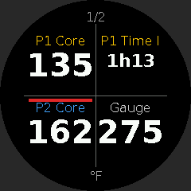
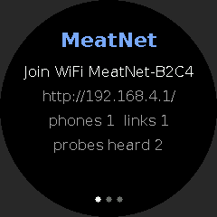

# MeatNet Display (ESP32-S3 + GC9A01A, MicroPython)

> [!NOTE]
> This project was written with the assistance of an LLM (Anthropic's Claude,
> via Claude Code). It has been tested on real hardware, but review the code
> before relying on it.

Turns a **Waveshare ESP32-S3-LCD-1.28** (or any ESP32-S3 with a GC9A01A round
LCD) into a Combustion Inc. **MeatNet node** that relays between the
Combustion phone app and probes/nodes that would otherwise be out of range,
and shows their readings on the round screen. Configured from a web UI (no
buttons needed).

What it does:

- **Advertises as a Display (product type 4)** and re-broadcasts every probe
  it hears as repeated MeatNet data (hop count set). The app sees live
  temperatures from probes that are out of its own range.
- **Relays probes you pick in the web UI.** It holds a BLE connection to each
  one and forwards the full Probe Status (0x45) to the app: predictions,
  food-safe status, alarms. It also routes the app's commands to the probe:
  set prediction, alarms, probe ID/colour, food safe, reset, silence alarms,
  and **log reads** for the cook graph. Requests are translated between the
  MeatNet node format and the probe's own UART format.
- **Behaves as a MeatNet node towards other nodes** (experimental):
  - answers Read Probe List, Node List and Network Topology;
  - sends heartbeats and Device Connected/Disconnected messages;
  - keeps link/unlink tables and syncs them with peers (0x73–0x7B);
  - syncs the thermometer list (0x4B);
  - can hold **upstream** links to other nodes (Booster/Display/Gauge/
    Engine), one or several. Their probes, Gauge and Engine data reach the
    app through this device, and commands are routed back. Linking both a
    Gauge and the Engine directly keeps the Engine reachable when the Gauge
    link drops (each takes a connection slot).
- **Round-screen readings** in two layouts: *rotate* (one big reading per
  page, with surface/ambient and time-to-ready underneath) or *quad* (four
  per page). An optional status page shows the IP, connections and probes
  heard. A red ring means a probe alarm is going off.

    
- **Web UI** at `http://meatnet.local/`:
  - live status and log;
  - probes and devices heard, with a relay checkbox per probe;
  - display settings and the list of readings to show;
  - WiFi scan and setup;
  - advanced options.

## Setup

### 1. Host tools

```
python -m pip install esptool mpremote
```

### 2. Flash MicroPython (v1.24 or newer)

Download **ESP32_GENERIC_S3** from
[micropython.org/download](https://micropython.org/download/ESP32_GENERIC_S3/).
The Waveshare board's ESP32-S3R2 has 2 MB of *quad* PSRAM, which the generic
S3 build detects. Use the `SPIRAM_OCT` variant only on boards with octal
PSRAM.

```
python -m esptool --chip esp32s3 --port <PORT> erase_flash
python -m esptool --chip esp32s3 --port <PORT> --baud 460800 write_flash 0 <firmware.bin>
```

Check PSRAM after flashing: `import gc; gc.mem_free()` should report well over
1 MB. The screen needs a 115 KB frame buffer.

The display works with stock firmware (pure-Python driver). If your firmware
includes the C `gc9a01` module (russhughes/gc9a01_mpy, e.g. Waveshare's
demo firmware), it's used automatically. Run `help('modules')` to see.

### 3. Deploy

From this directory:

```
python -m mpremote connect <PORT> mkdir :fonts + mkdir :www
python -m mpremote connect <PORT> cp util.py protocol.py central.py ble.py linktable.py meatnet.py readings.py power.py meater.py split.py config.py wifi.py display.py screen.py web.py main.py :
python -m mpremote connect <PORT> cp fonts/big.bin fonts/mid.bin fonts/med.bin fonts/small.bin :fonts/
python -m mpremote connect <PORT> cp www/index.html :www/
python -m mpremote connect <PORT> reset
```

Optionally copy `sample_config.json` to `config.json`, fill in your 2.4 GHz
WiFi, and copy it to the board too. Otherwise use the setup access point:

### 4. First run / WiFi setup

With no WiFi configured, or if the network can't be joined within 20 s, the
board starts an access point called **`MeatNet-XXXX`**, and the screen shows
its name and `http://192.168.4.1/`. Join it from your phone; most phones
open the setup page automatically. Pick your network, enter the password,
then **Save & reboot**. The board joins your network and the screen's status
page shows its IP. It's also reachable at `http://meatnet.local/`.

While in AP mode it retries the saved network every minute, as long as
nobody is connected to the setup AP.

### 5. Relay probes

In the web UI's **Probes** list, tick **Relay** on the probes this device
should connect to. The app then shows them through this Display, with
predictions and history, even when the phone can't reach the probe.

### Updating files on the board

`mpremote cp` interrupts the running app automatically. If it reports
`could not enter raw repl`, reset the board and press **Ctrl-C** within 3 s
of boot ("MeatNet starting in 3 s"). The app then doesn't start at all, so
nothing is using the radios:

1. `python -m mpremote connect <PORT> repl`, reset the board (button or
   replug), and press **Ctrl-C** at the start-up message. Don't press Ctrl-D:
   that soft-resets and runs the app.
2. Exit with **Ctrl-]**, then copy without a soft reset:
   `python -m mpremote connect <PORT> resume cp ble.py :`
3. `python -m mpremote connect <PORT> reset` to start the new code.

## MEATER Pro bridge

Publishes MEATER Pro probes on MeatNet as if they were Combustion probes, so
the Combustion app and other MeatNet devices see their temperatures. Turn on
**MEATER bridge** in the web UI, then tick the MEATER(s) to bridge and pick
the probe number each should show as (1–8).

- The MEATER only sends temperatures over a connection, so the device holds
  a link to each bridged MEATER. Each one uses a relay slot, shared with
  relayed Combustion probes. The MEATER app can't connect to that MEATER
  while it's bridged.
- Each bridged MEATER is advertised as a repeated Combustion probe (via this
  node, 1 hop) with serial `4Dxxxxxx`, derived from the MEATER's address.
  The sensors map as follows:
  - **T8 (ambient)** = MEATER ambient (handle) sensor.
  - **T1–T7** = the 5 MEATER tip sensors spread linearly: T1 = tip 1,
    T7 = tip 5, the rest interpolated.
  - **Core** = the lowest of T1–T6. Combustion's core field can't name T7.
  - **Surface** = T7.
  - **Low battery** is flagged below 20%.
- The Display also presents each bridged MEATER as one of its own MeatNet
  probes, the way it does for relayed probes. The app learns about probes
  reached through a node this way, not from repeated advertisements alone.
  - It's listed in the Display's probe list (0x44).
  - Its full probe status (0x45) is sent on every update, with a session ID,
    a 5 s sample period and "probe inserted, no prediction".
  - The Display answers session info (0x03).
  - It keeps a temperature log (last 6 h, every 5 s) so the app can
    back-fill the cook graph (0x04 log reads, sent paced).
  - It answers firmware/hardware/model-info requests (0x46–0x48), shaped
    like a real probe's (model `00001011:MEATER`, firmware `v2.4.0`).
  - It's added to the Display's linked-devices table and announced with
    Device Linked (0x77) when bridging starts. It stays linked after
    un-bridging; unlink it from the app if needed.
  - Setting the probe ID/colour from the app is applied to the bridge.
    Predictions, alarms, food safe and resets aren't possible for a MEATER,
    so the app gets a failure response.
- **Direct-probe advertisement (on by default):** each bridged MEATER is
  also advertised the way a probe advertises itself (product type 1). The
  Combustion app only *discovers* new probes from these; repeated data
  through a node only updates probes it already knows. It's sent
  **non-connectable**, so the app can't try to connect to the Display as if
  it were the probe and reaches it through the Display instead. To add it in
  the app, find it in the unlinked devices list and hold the phone close to
  the Display. The app only offers to link nearby devices. While that
  advert is in the rotation, phones can only connect during the Display's
  own advertising slots, so connecting can take a little longer.
- MEATERs are found by name or service UUID, which may only be in the scan
  response, so scanning is active (sends scan requests) while the bridge is
  on.
- A MEATER that stops sending for 10 s drops out of the advertisements.

## Two-unit setup (phone side + device side)

When your phone and the devices can't both be in Bluetooth range of one
board, split the job across two ESP32s on the same home WiFi:

| Unit | Role setting | Place it | Does |
|---|---|---|---|
| **App unit** | `app` | near the phone | Advertises as the Display, repeats probes, talks to the Combustion app, runs the screen and the main web UI with all probe/MEATER/display settings |
| **Field unit** | `field` | near the probes, MEATER, Gauge, Engine | Scans and holds the Bluetooth links to the devices; doesn't advertise and isn't visible to phones |

The field unit is a remote radio. It streams what it hears and its link
traffic to the app unit over WiFi, and the app unit runs all the MeatNet
logic as if the radio were its own. The field unit can be any ESP32. A
display is optional and shows a status page and the probes it hears.

Setup:

1. Deploy the same files to both boards, and give each one your WiFi
   through its setup access point.
2. On each board, open the web UI → **Advanced**. Set **Role** to `app` on
   one and `field` on the other, and enter the same **Shared key** on both.
   Then reboot both.
3. The field unit finds the app unit automatically from a UDP broadcast
   beacon. If your network blocks broadcasts, enter the app unit's IP
   under **App unit address** on the field unit.
4. Both Status cards show the other unit ("Two-unit: field unit … connected").
   Do all the configuration (relayed probes, MEATER bridge, upstream node,
   display) on the app unit. The field unit's page only shows its status,
   what it hears (with signal strength, handy for placing it), WiFi and
   Advanced.

Notes:

- The two units use TCP port 7389 (configurable) on your LAN. The shared key
  stops a stray device from attaching, but the traffic isn't encrypted.
- In this mode, all of the field unit's Bluetooth connections are available
  for devices. None are reserved for phones; phones connect to the app unit.
- If the field unit drops off WiFi, the app unit shows its links as
  "field unit offline". Relayed probes disappear until it's back, and then
  the links are re-opened automatically. Standby on the app unit also puts
  the field unit into standby.

### Running a unit on a Linux host

Either unit can run on a Linux PC or Raspberry Pi instead of an ESP32, using
the same shared code. Pair it with an ESP32 in the other role, or run both
units on one host to try the whole chain. It needs Python 3.10+, BlueZ
5.56+, and `bleak` (`python3 -m pip install bleak`, which also brings
`dbus_fast`). It runs as a normal user; no root is needed.

```
python3 -m host.run app   --key <shared key>                 # web UI on :8080
python3 -m host.run field --key <shared key> [--peer <ip>]   # web UI on :8081
```

- **App unit (`host/bluez_peripheral.py`):** advertises as the Display
  through BlueZ's advertising API, one instance per advertisement, which
  the controller cycles. It serves the UART and Device Information GATT
  services. Each advertisement carries the Combustion manufacturer data plus
  the 16-bit DFU UUID (0xFE59) in a single 31-byte packet with no flags.
  BlueZ notifies every subscribed phone at once; it can't target one
  connection. BlueZ also picks the advertising interval (about 1 s rather
  than the ESP32's 250 ms), so the app may take a little longer to find it.
- **Field unit (`host/bleak_central.py`):** scans and holds links with
  `bleak`.
- **Settings:** stored in `host/app.json` / `host/field.json` (git-ignored)
  and editable in each unit's web UI. "Reboot" in the web UI restarts the
  process.

### C++ field unit (ESP-IDF, in progress)

`firmware/` is a C++ port of the field unit on ESP-IDF + NimBLE. It speaks
the same WiFi protocol, so it pairs with the existing app unit (ESP32 or
Linux host). It exists mainly to get control the MicroPython unit lacks:
disconnect reasons, connection parameters, and WiFi/Bluetooth coexistence.
The plan and milestones are in `docs/field-unit-idf-plan.md`.

Milestone status: 1 (skeleton), 2 (WiFi session + scan streaming) and 3
(links: probes, nodes, MEATERs) are done, so it can replace the MicroPython
field unit. Every link drop is reported with its Bluetooth disconnect reason,
e.g. `error: supervision timeout (signal lost) (0x08)`, which also shows in
the app unit's log. Next: 4 (diagnostics and tuning), then 5 (setup page).

Build (ESP-IDF v5.5 installed in `~/esp/esp-idf`):

```
cd firmware
. ~/esp/esp-idf/export.sh
idf.py set-target esp32s3        # once; use esp32 for plain ESP32 boards
idf.py menuconfig                # "MeatNet field unit": bootstrap WiFi etc.
idf.py build
```

Bootstrap settings (WiFi, app unit address, shared key) live in the
git-ignored `sdkconfig` until the setup page arrives (milestone 5).

**Flashing the Waveshare ESP32-S3-LCD-1.28.** The board's USB-serial chip
(CH343) resets the ESP32 whenever the serial port is opened, but it can't
select download mode, and esptool's automatic reset doesn't enter it. So the
order matters:

1. Start the flash first, with esptool set to keep retrying the connection:
   `python -m esptool --chip esp32s3 -p /dev/serial/by-id/<CH343 device>
   --connect-attempts 0 write_flash @flash_args` (from `firmware/build`).
2. **Then** hold BOOT, press and release RESET, release BOOT. esptool
   connects and writes.
3. Afterwards, press RESET to run the new firmware. If it keeps landing in
   download mode (`boot:0x31 (DOWNLOAD…)` on the serial port, e.g. after
   MicroPython's `machine.bootloader()`), unplug the board for a few
   seconds.

Opening the serial port to read logs also restarts the board. Use the
`/dev/serial/by-id/…` path, since `/dev/ttyACM*` numbering changes on
replug.

## Standby and battery

**Standby** (Status → *Standby* in the web UI) idles the device while keeping
WiFi up, so the same page can wake it again:

- BLE stops advertising and drops all connections: phones, relayed probes and
  the upstream node. The probes' connection slots are freed for your phone or
  a real Display.
- BLE scanning drops to a ~3% duty cycle.
- The screen turns off (backlight off, panel asleep).
- The CPU runs at 80 MHz and WiFi uses its power-save mode.

Manual standby survives a reboot until you wake the device from the web UI.

**Auto standby** (Advanced, minutes, 0 = off): after that long with no probe
heard (e.g. all probes in the charger), the device enters standby by itself.
It wakes as soon as a probe advertises again, i.e. when one is taken out of
its charger.

**Battery:** the web UI's Status card and the screen's status page show the
cell voltage and an approximate charge %. The Waveshare board feeds the
battery to GPIO1 through a 200k/100k divider (ratio 3.0). Change the pin
(-1 = none) and ratio under Advanced for other boards. The percentage comes
from a typical LiPo voltage curve, so it's rough, and it reads high while
charging.

## Limits and things to know

- **BLE connection budget.** MicroPython's NimBLE build allows only a few
  simultaneous connections in total, inbound and outbound together (set
  `max_conn`, default 4). One is reserved for phones (`inbound_reserve`), and
  the rest go to relayed probes and any upstream nodes. The web UI
  shows how many relay slots are free. A probe accepts fewer than 3
  connections, so each probe this device relays takes one of that probe's
  slots.
- Probes must be heard **directly** before they can be relayed (their address
  comes from their advertisements).
- Advertisement repeating only carries live temperatures. Predictions, alarms,
  history and commands need **Relay** ticked.
- The MeatNet spec is marked DRAFT. Some details are best guesses and may
  need adjusting against the real app:
  - the DIS model string (`dis_model`, default `Timer REL-00001`);
  - the DIS firmware version (`dis_firmware`, default `v2.6.0`). If the app
    offers a firmware update, set this to the version it expects (Advanced →
    DIS firmware version). It applies right away; reconnect the app;
  - the heartbeat interval (5 s);
  - thermometer-list sync behaviour.
- Node-to-node features are experimental. Untick *MeatNet node messages* in
  Advanced if they cause trouble with your other devices.
- **The MEATER BLE protocol isn't public.** The MEATER bridge is based on
  observation and on code shared by the ESPHome user community, not on a
  published spec. It may miss details, and a MEATER firmware update could
  break it.

## Files

| File | Purpose |
|---|---|
| `protocol.py` | Wire formats: adverts, node and probe UART framing, 0x45, heartbeat, link tables |
| `meatnet.py` | Node logic: probe/device tables, link management, request routing, flooding with de-duplication |
| `ble.py` | BLE transport: GATT server, advertising rotation, passive scan, outbound link pool, notification queue |
| `central.py` | Outbound GATT link state machine (multi-service discovery, several notify characteristics) |
| `linktable.py` | Link/unlink tables persisted in `links.json` |
| `readings.py` | Configured readings → display items (formatting, pages) |
| `meater.py` | MEATER Pro decoding, sensor mapping and synthesized Combustion probe adverts |
| `firmware/` | C++ field unit on ESP-IDF + NimBLE (in progress); see `docs/field-unit-idf-plan.md` |
| `host/` | Linux host versions of the app unit (BlueZ D-Bus peripheral) and field unit (bleak), sharing all protocol/node code; `python3 -m host.run app|field` |
| `split.py` | Two-unit mode: field-side radio server, app-side remote radio and transport, WiFi protocol (TCP + UDP beacon) |
| `power.py` | Standby (manual/auto), CPU/WiFi power save, battery voltage via ADC |
| `screen.py` | Framebuffer renderer with bitmap fonts, pushed in row bands |
| `display.py` | GC9A01A output: C `gc9a01` module if present, else pure-Python SPI driver |
| `wifi.py` | Station mode with setup-AP fallback and captive DNS |
| `web.py`, `www/index.html` | Web UI server, JSON API, WebSocket status/log |
| `config.py` | Defaults and `config.json` persistence (pins default to the Waveshare board) |
| `main.py` | Wiring and asyncio tasks (10 Hz BLE, 1 Hz node tick, screen, WiFi, web, console) |
| `fonts/`, `tools/make_font.py` | Pre-rendered DejaVu bitmap fonts and the generator (needs Pillow) |
| `tools/preview.py`, `docs/preview/` | Host-side screen renderer (framebuf stand-in) and sample pages |
| `tests/` | Host tests (CPython + pytest) for protocol, node routing, readings |

## Development

```
python -m pytest tests          # host tests
python tools/make_font.py       # regenerate fonts (Pillow + DejaVu TTFs)
python tools/preview.py         # render sample screen pages to docs/preview/ (Pillow)
```

The pins default to the non-touch Waveshare board (SCK 10, MOSI 11, DC 8,
CS 9, RST 12, BL 40). Change them under Advanced → Display pins.

## License

MIT, see [LICENSE](LICENSE). Combustion, MeatNet and MEATER are trademarks of
their owners; this project isn't affiliated with or endorsed by them.
